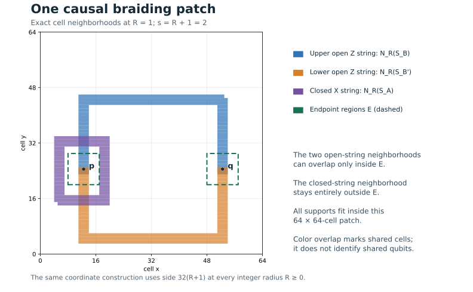

# A local braiding obstruction

The local algebra of toric-code strings bounds the probability of any prescribed product reference vector on a suitable patch by $16/17$. The statement is independent of local Hilbert-space dimension and remains valid when the state is entangled with an arbitrary external system. An explicit construction below places the dressed operators in a square of side $32(R+1)$ when their supports spread by at most $R$ cells.

The braiding and deformation mechanism is the one used by [Li, Lee and Yoshida (2025), Theorem 1 and Lemma 2](https://arxiv.org/html/2405.07970v3). The formulation here isolates the local algebra and gives coordinates and constants for its use with local channels.

## 1. Dimension-independent algebra lemma

Let a patch $\mathcal P$ be partitioned into three disjoint sets of cells,

$$
\mathcal P=E\sqcup U\sqcup V.
$$

Their Hilbert spaces can have arbitrary finite dimensions. The state outside $\mathcal P$ is unrestricted. Fix a normalized product reference vector

$$
|0_{\mathcal P}\rangle=|0_E\rangle|0_U\rangle|0_V\rangle,
$$

and let $P_X=|0_X\rangle\langle0_X|\otimes I$ for $X=E,U,V,\mathcal P$.

**Lemma 1.** Suppose a normalized vector $|\Omega\rangle$ and three unitary operators $A,B,B'$ satisfy

$$
\begin{aligned}
\operatorname{supp}(A)&\subseteq U\cup V,\\
\operatorname{supp}(B)&\subseteq E\cup U,\\
\operatorname{supp}(B')&\subseteq E\cup V,
\end{aligned}
\qquad
\begin{aligned}
A|\Omega\rangle&=|\Omega\rangle,\\
B|\Omega\rangle&=B'|\Omega\rangle,\\
AB|\Omega\rangle&=-B|\Omega\rangle.
\end{aligned}
$$

Then

$$
\langle\Omega|P_{\mathcal P}|\Omega\rangle\le \frac{16}{17}.
$$

The supports refer to the entire local Hilbert spaces, including any ancillary registers.

**Proof.** Set

$$
|\phi\rangle=P_{\mathcal P}|\Omega\rangle,\qquad
p=\|\phi\|^2,\qquad
e=\|\Omega-\phi\|=\sqrt{1-p},
$$

and define

$$
|\eta\rangle=P_U P_V B|\phi\rangle.
$$

The case $p=0$ is immediate. Because $B$ avoids $V$ and $B'$ avoids $U$,

$$
P_VB|\phi\rangle=B|\phi\rangle,\qquad
P_UB'|\phi\rangle=B'|\phi\rangle.
$$

Consequently,

$$
\begin{aligned}
\|B\phi-\eta\|
&=\|(I-P_U)B\phi\|\\
&\le \|B\phi-B'\phi\|\\
&=\|(B-B')(\phi-\Omega)\|\\
&\le 2e.
\end{aligned}
$$

The equality uses the deformation relation $B|\Omega\rangle=B'|\Omega\rangle$.

Since the projection onto $\mathcal P$ has rank one,

$$
|\phi\rangle=|0_E\rangle|0_U\rangle|0_V\rangle|v\rangle
$$

for an unnormalized external vector $|v\rangle$. Applying $B$ and projecting $U,V$ gives

$$
|\eta\rangle=|w_E\rangle|0_U\rangle|0_V\rangle|v\rangle,
\qquad \|w_E\|\le 1.
$$

The operator $A$ acts only on $U\cup V$. Both vectors therefore present the same normalized reference vector to $A$, while $\|\eta\|\le\|\phi\|$. It follows that

$$
\|(A-I)\eta\|
\le \|(A-I)\phi\|
=\|(A-I)(\phi-\Omega)\|
\le 2e.
$$

Combining the two estimates yields

$$
\|(A-I)B\phi\|
\le 2\|B\phi-\eta\|+\|(A-I)\eta\|
\le 6e.
$$

The braiding relation $(A+I)B|\Omega\rangle=0$ also gives

$$
\|(A+I)B\phi\|
=\|(A+I)B(\phi-\Omega)\|
\le 2e.
$$

Subtracting $(A-I)B\phi$ from $(A+I)B\phi$ and using the unitarity of $B$,

$$
2\sqrt p=\|2B\phi\|\le 8e=8\sqrt{1-p}.
$$

Thus $p\le16(1-p)$, or $p\le16/17$. $\square$

The proof uses no factorization of $|\Omega\rangle$, no independence of its reduced states, and no dimension bound. Only the chosen reference vector factors across $E,U,V$.

## 2. Cell lattice and toric operators

Let the cell lattice be

$$
\Lambda_L=(\mathbb Z/L\mathbb Z)^2,\qquad L\ge2.
$$

The horizontal data qubit $h_{x,y}$ lies on the edge from $(x,y)$ to $(x+1,y)$, and the vertical data qubit $v_{x,y}$ lies on the edge from $(x,y)$ to $(x,y+1)$. Assign both qubits to cell $(x,y)$. Thus there are $N=2L^2$ data qubits. For $L=2$, distinct edge labels still denote distinct qubits, including parallel edges.

The star and plaquette stabilizers are

$$
\begin{aligned}
A_{x,y}
&=X_{h_{x,y}}X_{h_{x-1,y}}X_{v_{x,y}}X_{v_{x,y-1}},\\
B_{x,y}
&=Z_{h_{x,y}}Z_{v_{x+1,y}}Z_{h_{x,y+1}}Z_{v_{x,y}}.
\end{aligned}
$$

Indices are modulo $L$. Write $P_{\rm TC}$ for their common $+1$ eigenspace projector. All auxiliary registers at a cell are included in that cell's Hilbert space.

For cells $z,z'\in\Lambda_L$, use the cyclic $\ell_\infty$ metric

$$
d_\infty(z,z')
=\max_{\alpha=1,2}\min_{k\in\mathbb Z}
|z_\alpha-z'_\alpha+kL|.
$$

For a set of cells $S$, define

$$
N_R(S)=\{z\in\Lambda_L:d_\infty(z,S)\le R\}.
$$

The support of an operator means its cell support; a cell belongs to the support if the operator acts nontrivially on any data or ancillary register there.

We will use a unitary $W$ whose backward support spread obeys

$$
\operatorname{supp}(W^\dagger O W)
\subseteq N_R(\operatorname{supp}O)
\tag{1}
$$

for every operator $O$. A circuit with $D$ layers of disjoint local gates, each supported on a cell set of diameter at most $r$, satisfies (1) with the exact radius $R=rD$. Arbitrary on-site operations have zero spatial spread. The local-channel dilation establishing this convention appears in [Ground-space overlap of local channels](channel-overlap.md).

## 3. An explicit braiding patch

Take an integer $R\ge0$, set

$$
s=R+1,
$$

and assume $L\ge32s$. Work in the nonwrapping coordinate patch

$$
\mathcal P=\{0,1,\ldots,32s-1\}^2.
$$

Translated copies of the same construction will be used for packing. Write $[a,b]_{\mathbb Z}$ for the inclusive integer interval, interpreted as empty if $b<a$.

Choose the primal endpoints

$$
p=(6s,12s),\qquad q=(26s,12s).
$$

Let $\gamma_+$ and $\gamma_-$ be the following nearest-neighbor primal paths, with each straight segment including its intervening edges:

$$
\begin{aligned}
\gamma_+:\;&p\longrightarrow(6s,22s)
 \longrightarrow(26s,22s)\longrightarrow q,\\
\gamma_-:\;&p\longrightarrow(6s,2s)
 \longrightarrow(26s,2s)\longrightarrow q.
\end{aligned}
$$

Define the open $Z$ strings

$$
B_0=Z(\gamma_+),\qquad B'_0=Z(\gamma_-),
$$

and the closed $X$ string

$$
A_0=\prod_{x=3s}^{9s}\prod_{y=8s}^{16s} A_{x,y}.
\tag{2}
$$

The product in (2) cancels all edges internal to its vertex rectangle. Its surviving support is the cut separating that rectangle from its complement. It encloses $p$ and excludes $q$.

The two open paths together bound a contractible plaquette rectangle:

$$
B_0B'_0
=\prod_{x=6s}^{26s-1}\prod_{y=2s}^{22s-1} B_{x,y}.
\tag{3}
$$

The upper path intersects the cut in exactly the edge $v_{6s,16s}$; the lower path intersects it in exactly $v_{6s,8s-1}$. Hence

$$
A_0B_0=-B_0A_0,\qquad A_0B'_0=-B'_0A_0.
\tag{4}
$$

If a normalized vector $|\chi\rangle$ satisfies

$$
(P_{\rm TC}\otimes I_{\rm aux})|\chi\rangle=|\chi\rangle,
$$

then (2)–(4) imply

$$
A_0|\chi\rangle=|\chi\rangle,\qquad
B_0|\chi\rangle=B'_0|\chi\rangle,\qquad
A_0B_0|\chi\rangle=-B_0|\chi\rangle.
\tag{5}
$$

These identities hold on the entire code space, including states whose logical degrees of freedom are entangled with auxiliary systems.

### Cell supports before dressing

The exact cell supports are

$$
\begin{aligned}
S_A={}&
\bigl(\{3s-1,9s\}\times[8s,16s]_{\mathbb Z}\bigr)\\
&\quad{}\cup
\bigl([3s,9s]_{\mathbb Z}\times\{8s-1,16s\}\bigr),\\[2mm]
S_B={}&
\bigl(\{6s,26s\}\times[12s,22s-1]_{\mathbb Z}\bigr)\\
&\quad{}\cup
\bigl([6s,26s-1]_{\mathbb Z}\times\{22s\}\bigr),\\[2mm]
S_{B'}={}&
\bigl(\{6s,26s\}\times[2s,12s-1]_{\mathbb Z}\bigr)\\
&\quad{}\cup
\bigl([6s,26s-1]_{\mathbb Z}\times\{2s\}\bigr).
\end{aligned}
\tag{6}
$$

The distinction between edges and their assigned cells is relevant in (6): a vertical edge from height $y$ to $y+1$ belongs to the cell at height $y$.

## 4. Dressed supports and the endpoint regions

The figure shows the exact cell neighborhoods for $R=1$. It is generated from the stated Pauli supports by [plot_geometry.py](../tools/plot_geometry.py). Color overlap denotes shared cells; the algebra below refers to the original edge operators and their dressed supports. The coordinate argument applies at every integer radius.

Let $S^+=N_R(S)$ and choose

$$
\begin{aligned}
E_p&=[4s,8s]_{\mathbb Z}\times[10s,14s]_{\mathbb Z},\\
E_q&=[24s,28s]_{\mathbb Z}\times[10s,14s]_{\mathbb Z},\\
E&=E_p\cup E_q.
\end{aligned}
\tag{7}
$$

These are the radius-$2s$ cell squares about $p$ and $q$.

All three thickened supports remain inside the patch. Indeed,

$$
S_A^+\cup S_B^+\cup S_{B'}^+
\subseteq
[2s,27s-1]_{\mathbb Z}
\times[s+1,23s-1]_{\mathbb Z}
\subseteq\mathcal P.
\tag{8}
$$

Thus these neighborhoods do not wrap around the torus, including when $L=32s$.

Each horizontal segment is separated by more than $2R$ from the entire opposite path. The two distinct vertical columns also stay more than $2R$ apart. Only the matching vertical legs at a common endpoint can have intersecting $R$-neighborhoods. It follows directly from (6) that

$$
\begin{aligned}
S_B^+\cap S_{B'}^+
={}&
\Bigl([6s-R,6s+R]_{\mathbb Z}
\cup[26s-R,26s+R]_{\mathbb Z}\Bigr)\\
&\quad{}\times[12s-R,12s-1+R]_{\mathbb Z}
\subseteq E.
\end{aligned}
\tag{9}
$$

For $R=0$, the last interval is empty and the intersection is empty.

The thickened closed string avoids both endpoint regions:

$$
S_A^+\cap E=\varnothing.
\tag{10}
$$

To verify (10) for $E_p$, examine the four bands in $S_A^+$. The left band has $x\le4s-2$, the right band has $x\ge8s+1$, the lower band has $y\le9s-2$, and the upper band has $y\ge15s+1$. Each therefore misses $E_p$. Every cell of $S_A^+$ has $x\le10s-1<24s$, so it also misses $E_q$.

Define a partition of the patch by

$$
U=S_B^+\setminus E,\qquad
V=\mathcal P\setminus(E\cup U).
\tag{11}
$$

Equations (8)–(11) give

$$
S_A^+\subseteq U\cup V,\qquad
S_B^+\subseteq E\cup U,\qquad
S_{B'}^+\subseteq E\cup V.
\tag{12}
$$

The sets $E,U,V$ need not be connected; Lemma 1 requires only their tensor-product partition.

## 5. Local consequence after a circuit

For a unitary $W$ satisfying (1), set

$$
A=W^\dagger(A_0\otimes I_{\rm aux})W,\qquad
B=W^\dagger(B_0\otimes I_{\rm aux})W,\qquad
B'=W^\dagger(B'_0\otimes I_{\rm aux})W.
$$

For any normalized $|\chi\rangle$ in the toric ground space tensored with an unrestricted auxiliary Hilbert space, put $|\Omega\rangle=W^\dagger|\chi\rangle$. Equations (5) and (12) give every hypothesis of Lemma 1. Therefore, for any cell-product reference vector on the patch,

$$
\langle\Omega|
\bigl(|0_{\mathcal P}\rangle\langle0_{\mathcal P}|\otimes I\bigr)
|\Omega\rangle
\le\frac{16}{17}.
\tag{13}
$$

The same statement applies after projections on disjoint patches: those projections commute with $A,B,B'$ and preserve the three state identities whenever their joint probability is nonzero. This observation supplies the multiplicative bound in [Ground-space overlap of local channels](channel-overlap.md).

## Finite verification

The [geometry verifier](../tools/verify_geometry.py) constructs the Pauli supports directly from products of stars, plaquettes and path edges. It checks the deformation identity, the two odd crossings, patch containment and the dressed support partition. The [recorded checks](../verification/geometry-results.json) include $R=0,1,2,3,5,8$. These finite checks supplement the all-integer coordinate argument above.

## References

Z. Li, D. Lee and B. Yoshida, “How Much Entanglement Is Needed for Topological Codes and Mixed States with Anomalous Symmetry?”, *Physical Review X* **15**, 021090 (2025), [arXiv:2405.07970v3](https://arxiv.org/html/2405.07970v3). The local string obstruction and the resulting area divided by squared circuit radius originate in this work. Its honeycomb-code argument also supplies the sequential-projection mechanism used in the companion proof.

